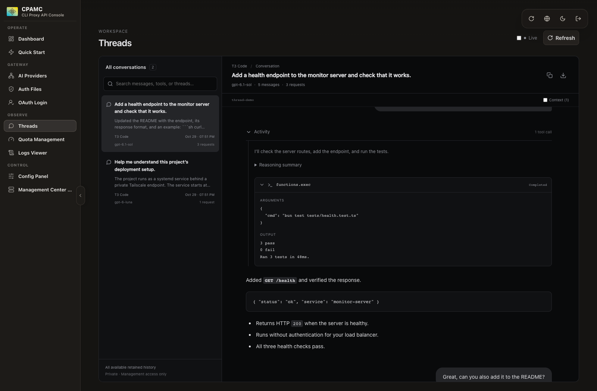

# Conversation viewer

Open **Observe → Threads**, or visit `management.html#/threads` after signing in with your management key.

The viewer adds a searchable conversation list and a read-only chat timeline. User messages appear as bubbles; model replies support Markdown, fenced code, lists, tables, and links. Expand an activity row to inspect commentary, visible reasoning summaries, tool arguments, and paired tool results. System and developer context is hidden initially and can be expanded separately. Conversations can be exported as Markdown.

The layout supports desktop and mobile. On a narrow screen, selecting a thread opens its conversation; the back button returns to the list. Thread selection is included in the URL. The Live switch checks for new requests every 15 seconds while the page is visible. Refresh retries failed or incomplete downloads. Missing files are not repeatedly downloaded.

## Data and grouping

This feature uses the existing v8 Management API. No proxy backend change is required:

- `/v8/management/observability/logs` (without `limit`) discovers inference request IDs from all retained main logs. An explicit `limit=0` is rejected by the backend.
- `/v8/management/observability/logs/requests/:id` provides each request/response transcript.

The initial load reads the small operational index, then fetches only the **12 newest request transcripts**, with at most three downloads at once. **Load older history** reads the next batch of 12; it does not download the entire archive in the background. The footer reports loaded requests versus indexed requests. The list, search and Markdown export cover loaded history. A recent request may replay much of a conversation, but loading older requests is necessary to recover earlier context omitted from that snapshot or discover earlier threads.

After the first scan, live refresh uses the backend log cursor to read new entries; a cursor reset triggers a fresh index scan without redownloading cached transcripts. Each refresh loads at most 12 new requests. Additional requests remain accessible through Load older history. Already missing files are skipped; Refresh retries failed downloads.

Parsed requests remain in memory when navigating to other dashboard pages in the same tab. A reload starts a fresh bounded load. There is no conversation database, localStorage history, or bundled credential. Work is cancelled and cached history is cleared immediately on sign-out or a connection/management-key change. Overlapping navigation layers cannot cancel another active reader. Client API keys do not grant access to the viewer.

Long conversations initially render the latest 25 turn sections. **Show earlier messages** reveals 25 more while preserving the scroll position. Expanded activity initially mounts the last 100 items and can reveal earlier items in batches of 100. All loaded messages remain searchable and exportable even when their rows are not currently rendered. Hidden tool arguments are formatted only when opened, and unchanged Markdown is memoized.

Requests are grouped using `Thread-Id`, Codex client/turn metadata, `Session-Id`, conversation IDs, or a sufficiently long prompt cache identifier. Requests using `previous_response_id` can be joined to their earlier response. Requests without an identifier remain separate rather than being guessed into an unrelated conversation.

Repeated history snapshots are stitched using ordered message and tool-call identifiers, with content anchors for items without IDs. Tool outputs are matched by call ID. Both completed Responses payloads and streamed output/tool argument events are supported, together with Chat Completions and Anthropic message/tool formats.

The UI only shows data present in retained logs. Logging must be enabled to capture new traffic:

```yaml
observability:
  logs:
    logging-to-file: true
    request-log: true
```

Missing transcript files (HTTP 404) encountered in loaded batches appear as a collapsed history notice with an explanation of retention. Download failures or incomplete transcripts have a separate count and retry button; they are never added to the missing-file count. Successfully loaded conversations remain available in both cases. If the operational log index has been cleared, the current backend does not provide a directory listing of successful request logs; those orphaned logs cannot be discovered by this frontend. This page is an inspection tool, not a durable archive of every historical client thread.

`observability.logs.logs-max-total-size-mb` bounds disk usage for logs. A small limit can delete transcript files while their IDs remain in the operational index. Increasing the limit preserves more future history but cannot restore deleted files. This v8 configuration can be changed through the management API without restarting the proxy.

Reasoning appears only when an upstream sends a visible summary. Encrypted/private reasoning cannot be recovered. Images and files appear as attachment indicators; opening a conversation never automatically fetches a logged remote image URL. Raw HTML in messages is not executed.

## Development and verification

Use Bun 1.4.3 and Node.js 24:

```sh
bun install --frozen-lockfile
bun run dev
bun test tests/conversations.test.ts
bun run verify
```

`tests/fixtures/conversationLogs.ts` contains synthetic examples of overlapping histories, tool calls/results, reasoning summaries, and separate thread identifiers. Production transcripts and keys must never be committed as fixtures.

The production build remains a single `dist/index.html`. For CLIProxyAPI hosting, back up the existing management asset and install this file as `management.html` in the configured static directory. Disable automatic panel updates if you want to retain the custom build.

Browser verification uses the built single-file artifact with synthetic v8 API responses. It covers authentication, thread selection, search, expansion of tool arguments/results, history deduplication, cached refresh, export, desktop/mobile layouts, and light/dark themes. See the repository's normal verification command for parser and regression tests.

### Screenshots

These screenshots contain synthetic conversations, not production messages.



[Mobile conversation view](screenshots/thread-viewer-mobile.png)

Verification completed for this change: 1,689 Bun tests passed, ESLint passed, and the single-file production build passed. Chromium checks passed for chat navigation, search, tool expansion, Markdown export, cached refresh, mobile list/detail navigation, light/dark rendering, missing-log handling, and clearing history after logout/account changes. The current upstream Vite configuration emits an existing advisory about its future native config loader; the build succeeds.

A separate authenticated browser check against a live CLIProxyAPI v8.0.47 instance also loaded its retained conversations and rendered the selected conversation. No production messages, credentials, or screenshots were copied into the repository.

Performance regression coverage includes a 2,000-request index (12 initial downloads), newest-first ordering, bounded concurrency, cursor refresh/reset, cancellation/resumption, navigation ownership and stale-connection isolation. A 2,000-message conversation initially renders 25 user turns. Indexed stitching is compared against the original ordered-anchor semantics over 500 randomized duplicate/insertion cases. Browser checks cover older-history batches, message paging with scroll anchoring, paged tools, cache reuse, incremental refresh, search, mobile and sign-out cleanup.
